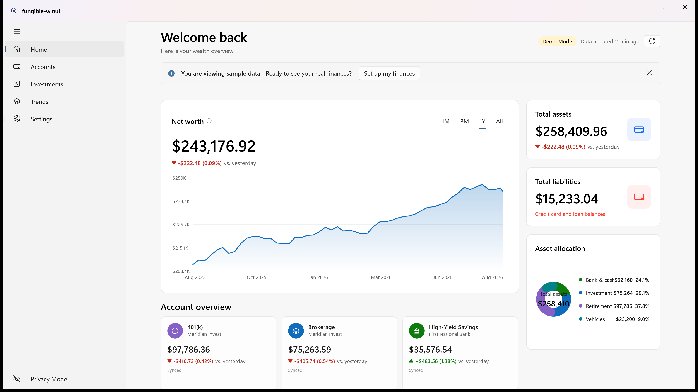
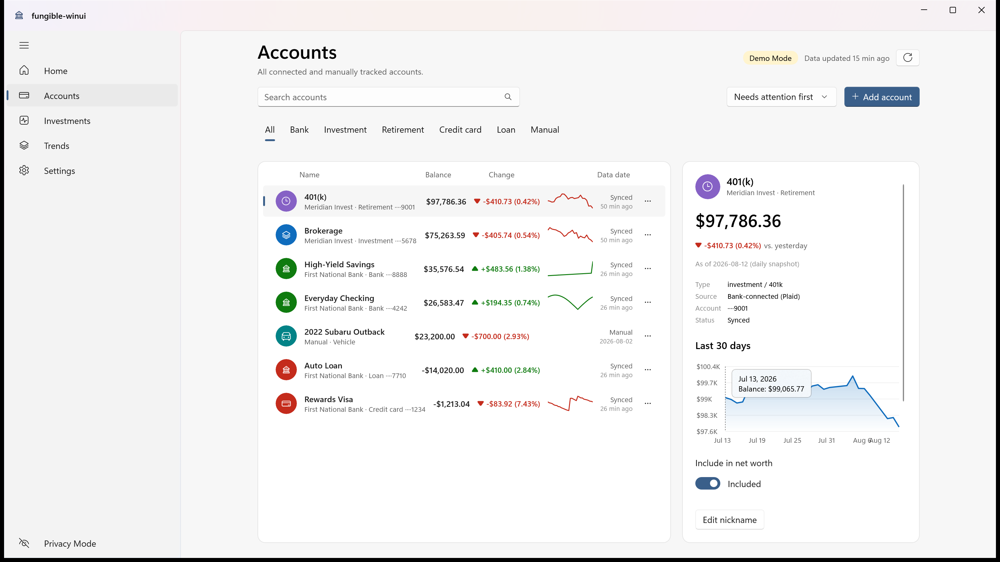
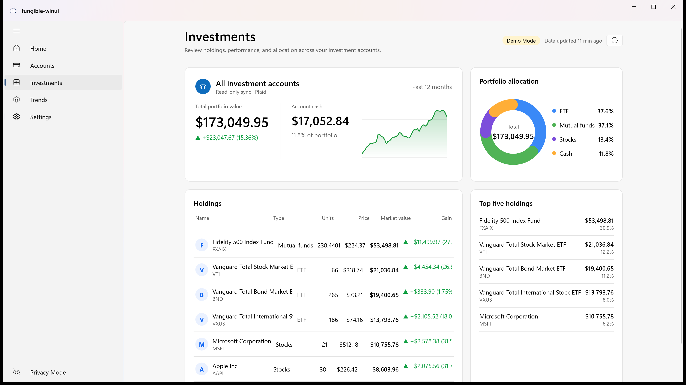
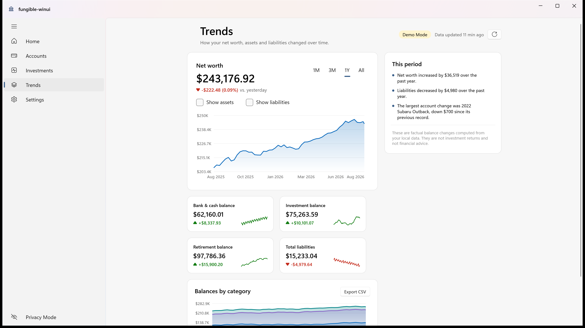

# AssetScope

<p align="center">
  
</p>

<p align="center">
  <strong>A modern, local-first personal net-worth and investment tracker for Windows 11.</strong>
</p>

<p align="center">
  <a href="https://github.com/SpookySandwich/AssetScope/stargazers"></a>
  <a href="https://github.com/SpookySandwich/AssetScope/releases"></a>
  <a href="LICENSE"></a>
  
  
  
</p>

<p align="center">
  
</p>

<details>
<summary>📸 <strong>Click to view more screenshots (Accounts, Investments, Trends)</strong></summary>
<br />

| Accounts & Detail View | Investments & Holdings |
| :---: | :---: |
|  |  |

| Historical Trends & Growth Analysis |
| :---: |
|  |

</details>

---

## ✨ Overview

**AssetScope** unifies your checking, savings, credit cards, brokerage holdings, crypto, real estate, and physical assets into a single real-time net-worth command center.

Built from the ground up for Windows 11 with native **WinUI 3 Fluent Design** and a high-performance **TypeScript/SQLite sidecar engine**, AssetScope gives you the power of modern financial aggregators without sacrificing privacy or performance.

### Why AssetScope?

* 🔒 **100% Local-First & Zero Telemetry:** Your balances and transaction history never leave your machine. They live in a local SQLite database at `%USERPROFILE%\.assetscope\assetscope.db`.
* 🛡️ **Guaranteed Read-Only:** AssetScope has no endpoints or permissions to trade, transfer money, or execute orders.
* 🔑 **Hardware & OS-Secured Credentials:** Provider tokens and API keys are stored exclusively in **Windows Credential Manager**—never in plain-text config files.
* 🏦 **Automated & Manual Aggregation:**
  * **Plaid:** Sync bank balances, loans, and credit cards.
  * **SnapTrade:** Sync brokerage accounts, real-time stock/ETF positions, transactions, and cost basis.
  * **Manual Assets & Liabilities:** Track vehicles, real estate, precious metals, and offline debts with historical timelines.
* 📊 **Precision Financial Semantics:**
  * Cost-basis FIFO matching for realized profit/loss.
  * True as-of balance carry-forward across historical gaps.
  * Customized account nicknames that permanently override upstream bank labels.
* ⚡ **Headless CLI & AI Skills Included:** Automate exports, run diagnostics, or query your finances with local AI assistants via the built-in CLI and Claude Code skill.

---

## 🏗️ Architecture

AssetScope separates UI presentation from financial logic via a decoupled, local loopback architecture:

```text
┌─────────────────────────────────────────────────────────────┐
│                 WinUI 3 Fluent Desktop App                 │
│                   (winui/AssetScope.App)                    │
│      Mica backdrop • Dark/Light Mode • Custom Charts        │
└──────────────────────────────┬──────────────────────────────┘
                               │ Loopback HTTP (Bearer Token)
                               ▼
┌─────────────────────────────────────────────────────────────┐
│              Local TypeScript Backend Sidecar               │
│                        (native-api)                         │
│   Account Normalization • Net Worth Math • Atomic Sync      │
└──────────────┬───────────────────────────────┬──────────────┘
               │                               │
               ▼                               ▼
┌──────────────────────────────┐ ┌────────────────────────────┐
│      Windows Credential      │ │    Local SQLite Database   │
│           Manager            │ │  (LibSQL / Atomic Commits) │
│    (Plaid / SnapTrade Keys)  │ │   (%USERPROFILE%\.assetscope)│
└──────────────────────────────┘ └────────────────────────────┘
```

`native-api` is AssetScope's backend, not a third-party service: it runs locally on your machine and owns storage, encryption, provider sync, and all financial math.

---

## 🚀 Quick Start

### Installation

Run the one-line automated installer in PowerShell:

```powershell
powershell -ExecutionPolicy Bypass -File build/install-winui.ps1
```

This installs AssetScope to `%LOCALAPPDATA%\Programs\AssetScope`, packages a dedicated local Node.js runtime, creates a Start Menu shortcut, and registers background daily sync.

### Building from Source

**Prerequisites:**
* Windows 11 x64
* [.NET SDK 10+](https://dotnet.microsoft.com/download)
* [Node.js 22+ LTS](https://nodejs.org)

```powershell
# 1. Clone the repository
git clone https://github.com/SpookySandwich/AssetScope.git
cd AssetScope

# 2. Install dependencies & run tests
npm ci
npm run typecheck
npm test

# 3. Test & build the WinUI 3 App
dotnet test winui/AssetScope.Tests/AssetScope.Tests.csproj -c Release -p:Platform=x64
dotnet build winui/AssetScope.App/AssetScope.App.csproj -c Release -p:Platform=x64
```

---

## 💻 Headless CLI & AI Agent Integration

AssetScope includes a complete CLI that interacts with the local engine:

```powershell
# Display full portfolio summary
.\bin\assetscope.cmd summary

# Tabular view of all accounts
.\bin\assetscope.cmd accounts --table

# Investment holdings & realized P&L
.\bin\assetscope.cmd investments

# Export privacy-redacted snapshot for reporting/AI
.\bin\assetscope.cmd snapshot --redact --out portfolio.json
```

### Claude Code Skill
AssetScope includes an AI assistant skill under `.claude/skills/assetscope` for querying portfolio totals, spending trends, investment breakdowns, and card rewards directly within terminal conversations. The installer copies it to `%USERPROFILE%\.claude\skills\assetscope` on every install when Claude Code is set up on the machine, so it always matches the installed CLI. Copy it by hand otherwise.

---

## 🔒 Privacy & Security Model

| Component | Storage Location | Security Mechanism |
| :--- | :--- | :--- |
| **Financial Balances & History** | `%USERPROFILE%\.assetscope\assetscope.db` | Local SQLite, zero remote uploads |
| **Plaid / SnapTrade Secrets** | Windows Credential Manager | OS-level DPAPI encryption |
| **Desktop / Sidecar Transport** | `127.0.0.1:<random-port>` | Per-session ephemeral bearer token |
| **Automated Backups** | `%USERPROFILE%\.assetscope\backups` | Point-in-time SQLite snapshots |

---

## 📖 Documentation

* [Architecture & Semantics](docs/architecture.md) — Comprehensive technical guide to data storage, balance calculation rules, and WinUI design principles.
* [Troubleshooting Guide](docs/troubleshooting.md) — Debugging launch issues, sync recovery, and custom account naming.

---

## 🤝 Contributing

Contributions, bug reports, and feature suggestions are warmly welcome!

1. Fork the Project
2. Create your Feature Branch (`git checkout -b feature/AmazingFeature`)
3. Run tests (`npm test` and `dotnet test winui/AssetScope.Tests/AssetScope.Tests.csproj`)
4. Commit your Changes (`git commit -m 'feat: add amazing feature'`)
5. Push to the Branch (`git push origin feature/AmazingFeature`)
6. Open a Pull Request

---

## 🙏 Acknowledgements

AssetScope originated as an independent project adapting early foundational concepts from the open-source [Fungible](https://github.com/tomfunk/fungible) project by [Thomas Funk](https://github.com/tomfunk) and contributors. While AssetScope has since evolved into a dedicated native Windows 11 WinUI 3 application with standalone financial services, multi-provider synchronization (Plaid + SnapTrade), and distinct architecture, we gratefully acknowledge Fungible's open-source work. Full third-party notices and licenses are documented in [`THIRD_PARTY_NOTICES.txt`](THIRD_PARTY_NOTICES.txt).

---

## 📄 License

Distributed under the **MIT License**. See [`LICENSE`](LICENSE) and [`THIRD_PARTY_NOTICES.txt`](THIRD_PARTY_NOTICES.txt) for details.

